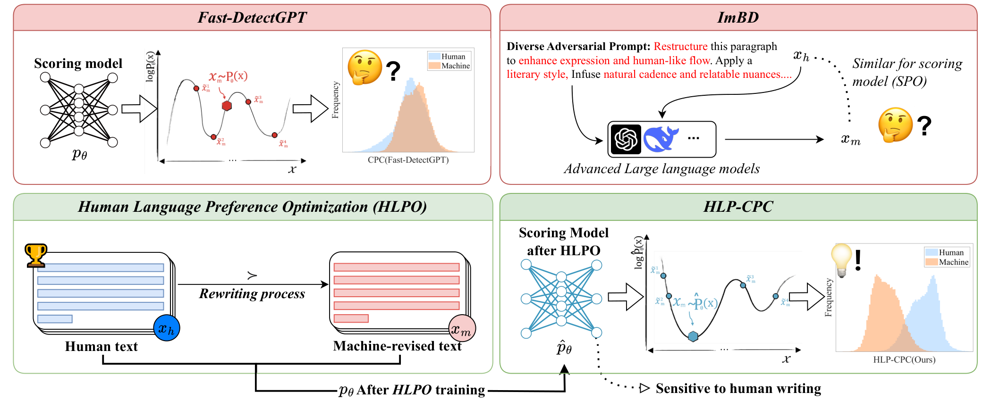
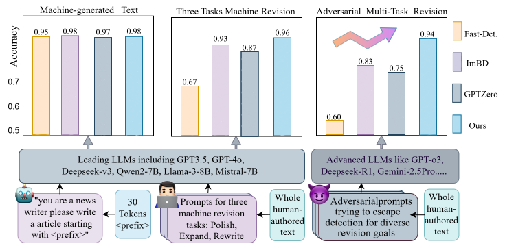
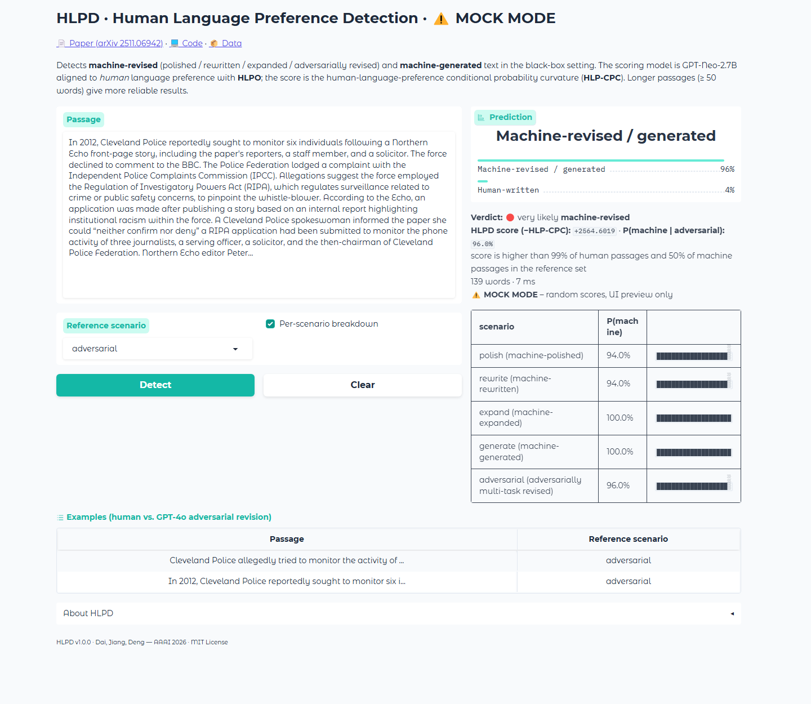

<h1 align="center">HLPD: Aligning LLMs to Human Language Preference<br>for Machine-Revised Text Detection</h1>

<p align="center"><b>AAAI 2026</b></p>

<p align="center">
  <a href="https://github.com/dfq2021">Fangqi Dai</a>, Xingjian Jiang, Zizhuang Deng
</p>

<p align="center">
  <a href="https://arxiv.org/abs/2511.06942"></a>
  <a href="https://www.python.org/downloads/release/python-3100/"></a>
  <a href="LICENSE"></a>
  <a href="https://github.com/dfq2021/HLPD/stargazers"></a>
  <a href="https://github.com/dfq2021/HLPD/issues"></a>
</p>

<p align="center">
  📄 <a href="https://arxiv.org/abs/2511.06942"><b>Paper</b></a> &nbsp;|&nbsp;
  📦 <a href="data/README.md"><b>Data</b></a> &nbsp;|&nbsp;
  🤗 <b>Model</b> (coming soon) &nbsp;|&nbsp;
  🖥️ <a href="app/app.py"><b>Demo</b></a> &nbsp;|&nbsp;
  📊 <a href="results/README.md"><b>Results</b></a>
</p>

---

Detectors such as Fast-DetectGPT and ImBD work well when machine-style cues are strong, but degrade
on **machine-revised** text — human writing that was polished, rewritten or expanded by an LLM —
especially under **adversarial prompts** ("make it sound as human as possible") and with
**advanced LLMs** whose styles keep changing. **HLPD** takes the opposite direction of ImBD:
instead of imitating machine style, it aligns the scoring model to the *stable* human writing
style.

* **HLPO** (Human Language Preference Optimization) — a reward-based alignment that trains a
  LoRA-tuned GPT-Neo-2.7B on pairs *(human text ≻ machine-revised text)* with a **linear
  contrastive loss** and a variance-aware **Dynamic-β** scheduler (no sigmoid saturation, stable
  with tiny data).
* **HLP-CPC** — the conditional probability curvature of Fast-DetectGPT evaluated under the
  human-aligned scorer; human text sits at positive curvature, machine-revised text at negative.
* **Adversarial multi-task benchmark** — a five-dimensional prompt generator
  (goal × style × "sound human" × constraint × request) drives GPT-4o, Claude-3.5, DeepSeek-R1 and
  Gemini-2.5-Pro to produce diverse revision attacks; plus fully generated text from advanced LLMs.

<p align="center">
  
</p>

## 🔥 News

* **[2026-09]** Code, data, paper results and the interactive demo (CLI + web UI) are released.
* **[2025-12]** arXiv v3 (camera-ready) is online.
* **[2025-11]** 🎉 HLPD is accepted by **AAAI 2026**.

## 📈 Results at a glance (AUROC)

| Setting | Fast-DetectGPT | GPTZero | ImBD | **HLPD** |
|---|---:|---:|---:|---:|
| Rewrite by GPT-3.5 / GPT-4o, 5 domains (Table 1) | 0.4588 | 0.7944 | 0.7870 | **0.9144** |
| Adversarial multi-task revision, 4 LLMs × 4 domains (Table 3) | 0.3914 | 0.7599 | 0.8337 | **0.9463** |
| Generation by advanced LLMs (Table 2) | 0.6324 | 0.7499 | 0.9228 | **0.9738** |
| Inference cost (s / 1k words, L20) | 0.72 | 1.64 | 0.72 | **0.72** |

HLPD also gives the best average AUROC on the open-source revisers (Qwen2-7B, Llama-3-8B, Mistral-7B,
Deepseek-7B), on Chinese / Portuguese / Spanish, over 1–5 revision iterations and from 30 to 180 words.
Raw per-passage scores of every reported run are in [`results/paper`](results/README.md).

<p align="center">
  
</p>

## 🆚 HLPD vs. ImBD

| | ImBD (AAAI 2025) | **HLPD (this repo)** |
|---|---|---|
| alignment target | machine style (`x_m ≻ x_h`, SPO) | **human language preference** (`x_h ≻ x_m`, HLPO) |
| objective | `−log σ(β·r)` (DPO-style) | **linear** `−β_t·r` + **Dynamic-β** (variance-aware schedule) |
| detection statistic | Style-CPC | **HLP-CPC** (`−d(x)`) |
| training data | 500 GPT-3.5 polished pairs | 3,354 multi-task revised pairs (same human sources) |
| benchmark | polish / rewrite / expand / generate | + **adversarial multi-task revision**, advanced-LLM generation, iterative revision |
| checkpoints | full state dict | **LoRA adapter only** (a few MB), legacy checkpoints still load |
| demo | CLI | **CLI + Gradio web UI**, batch mode, per-scenario calibration |

## 🛠️ Setup

```bash
conda create -n hlpd python=3.10 -y
conda activate hlpd
pip install -r requirements.txt

bash scripts/download_model.sh                 # GPT-Neo-2.7B  -> ./models/gpt-neo-2.7B
```

Then obtain the HLPD scorer (a LoRA adapter on GPT-Neo-2.7B, a few MB):

```bash
bash scripts/train_hlpo.sh                                                       # HLPO training, ~25 min on one L20
bash scripts/export_inference_ckpt.sh ckpt/hlpd_multitask_hlpo_lr_0.0001_beta_0.05_a_1   # -> ./models/HLPD-inference
```

> The pre-trained adapter will be released on Hugging Face (`scripts/download_inference_checkpoint.sh`);
> until then train it with the command above. Legacy full-state checkpoints (`ours-finetuned.pth`)
> are converted by the same export script.

## 🖥️ Local demo (CLI + web UI)

**GPU memory: ~11 GB** (`--fp16` roughly halves it; `--device cpu` works but is slow).

### Command line

```bash
bash scripts/run_demo.sh                      # interactive
python -m hlpd.detect --text "…"              # one passage
python -m hlpd.detect --file passages.txt --output scores.json   # batch (blank-line separated)
```

```
  _   _  _     ____   ____
 | | | || |   |  _ \ |  _ \    Human Language Preference Detection
 | |_| || |   | |_) || | | |   machine-revised & machine-generated text detector
 |  _  || |___|  __/ | |_| |   AAAI 2026  ·  v1.0.0
 |_| |_||_____|_|    |____/

Please enter your text (finish with an empty line, or type 'q' to quit):
...
  HLPD score (−HLP-CPC) : +1.8342
  P(machine-revised/generated) :  91.3%  [###########################---]
  Verdict               : very likely MACHINE-revised
  Per-scenario probability:
    polish        88.0%  [##################--]
    rewrite       93.5%  [###################-]
    expand        90.2%  [##################--]
    generate      95.1%  [###################-]
    adversarial   89.7%  [##################--]
```

`--scenario {polish,rewrite,expand,generate,adversarial,all}` chooses the reference score
distribution used to calibrate the probability (`local_infer_ref/`), `--detail` prints all of them.

### Web UI (Gradio)

```bash
bash scripts/run_app.sh            # http://127.0.0.1:7860
bash scripts/run_app.sh --share    # temporary public link
python app/app.py --mock           # preview the interface without a model / GPU
```

The page shows the human / machine probability, the raw HLPD score, where the score falls in the
human and machine reference distributions, a per-scenario breakdown and two built-in examples
(a human XSum passage and its GPT-4o adversarial revision), which are scored as soon as the page opens.

<p align="center">
  <br>
  <sub>Web UI (screenshot taken with <code>--mock</code>; the layout is identical with the real model).</sub>
</p>

## 🚀 Reproduce the paper

### Fast evaluation with the inference checkpoint (~11 GB)

```bash
bash scripts/eval_all.sh            # every benchmark -> ./evaluation/<benchmark>/*.hlpd.json
python tools/show_results.py --result_path evaluation --table
```

### Train HLPD with HLPO (~40 GB, two models in memory)

```bash
bash scripts/train_hlpo.sh          # 2 epochs, lr 1e-4, β0 = 0.05, 3,354 pairs  (~12 min / epoch on an L20)
bash scripts/export_inference_ckpt.sh ckpt/hlpd_multitask_hlpo_lr_0.0001_beta_0.05_a_1
```

Key options of `python -m hlpd.train`:

| option | default | meaning |
|---|---|---|
| `--loss {linear,sigmoid}` | `linear` | HLPO objective (`‡`) or DPO/ImBD-style sigmoid |
| `--no_dynamic_beta` | off | fixed β instead of the Dynamic-β scheduler (`⋆`) |
| `--beta` | 0.05 | initial / fixed β |
| `--datanum` | −1 (all) | number of training pairs |
| `--train_dataset` | multi-task set | any `original` / `sampled` paired file |
| `--eval_only --from_pretrained <dir>` | | evaluate a trained adapter (or a legacy `ours-finetuned.pth` checkpoint) |

### Evaluate a trained checkpoint on the benchmarks

```bash
bash scripts/eval_hlpd_adversarial.sh              # Table 3 (adversarial multi-task) + Table 2 (advanced LLMs)
bash scripts/eval_hlpd_single_task.sh rewrite      # Tables 1 / 10 / 11   (also: polish expand generation)
bash scripts/eval_hlpd_iterative.sh                # Table 8
bash scripts/eval_hlpd_truncation.sh               # Fig. 9 / 10
bash scripts/train_hlpo_multilang.sh               # Fig. 8 (Chinese / Portuguese / Spanish)
bash scripts/train_hlpo_multiseed.sh               # five seeds, 95% CI (Fig. 4 / 5)
```

### Baselines and ablations

```bash
bash scripts/download_other_models.sh               # GPT-J, T5-3B, RoBERTa detectors
bash scripts/eval_other_models.sh adversarial_multitask   # Likelihood … Fast-DetectGPT (also: rewrite polish expand generation)
bash scripts/eval_supervised.sh adversarial_multitask     # RoBERTa-base / -large
GPTZERO_API_KEY=… bash scripts/eval_gptzero.sh adversarial_multitask
bash scripts/eval_ablation.sh                      # Table 4: sigmoid/linear × fixed/Dynamic-β, SFT / ORPO / RLHF
```

To compare with ImBD under identical conditions, train the ImBD objective on ImBD's data with
`python -m hlpd.train --loss sigmoid --no_dynamic_beta --train_dataset data/train/imbd_polish_500.raw_data.json --datanum 500`
(note that HLPO prefers the *human* side; ImBD's own code prefers the machine side).

## 📦 Data

```
data/
├── train/train_multitask_revision.raw_data.json    3,354 (human, machine-revised) pairs for HLPO
├── adversarial_multitask/<llm>/<dataset>_adversarial_<llm>.raw_data.json     4 LLMs × 4 domains × 150 pairs
├── advanced_generation/<llm>/xsum_generation_<llm>.raw_data.json             Claude-3.5 / DeepSeek-R1 / Gemini-2.5-Pro / Grok-3
├── single_task/{polish,rewrite,expand,generation}/<llm>/…                    ImBD protocol, 6 (+4) source models
├── multilingual/  iterative_revision/  truncation/  prompts/  raw/
```

See [`data/README.md`](data/README.md) for the full data card. To build new adversarial data:

```bash
export HLPD_API_BASE=https://api.openai.com/v1 HLPD_API_KEY=sk-...
python tools/adversarial_prompt_generator.py --n 750 --model deepseek-reasoner      # stage 1: prompt pool
python tools/build_revision_data.py --task adversarial --model gpt-4o \
    --input data/raw/xsum.raw_data.json --prompts data/prompts/adversarial_prompts.json \
    --output data/adversarial_multitask/gpt-4o/xsum_adversarial_gpt-4o.raw_data.json  # stage 2: revisions
```

## 🎭 Humanization attack (Sec. 3.5)

The human-aligned scorer can also *select* the most human-looking perturbation of a machine-revised
passage. Four iterations reduce GPTZero's AUROC by 20% and its AI probability by 74%:

```bash
bash scripts/humanize.sh     # T5-3B perturbations × 100, top-1 by the HLPD scorer, 4 iterations
```

## 📁 Repository layout

```
hlpd/                 core package: model.py (HLPDScorer, HLP-CPC), hlpo_loss.py (HLPO + Dynamic-β), engine.py,
                      train.py, train_multiseed.py, evaluate.py, detect.py (CLI), export_inference_ckpt.py
app/app.py            Gradio web demo
scripts/              one-line entry points for every experiment
tools/                data construction, humanization, result tables and plots
other_models/         zero-shot / supervised baselines (Fast-DetectGPT family) + GPTZero
ablation_exp/         SFT / RLHF / ORPO alignment baselines
data/  results/       benchmarks and paper results
local_infer_ref/      reference score distributions used by the demos
```

## ✅ TODO

- [x] HLPO training / HLP-CPC evaluation code, LoRA-only checkpoints
- [x] Adversarial multi-task benchmark, advanced-LLM generations, multilingual / iterative / truncation sets
- [x] Command-line and web demos
- [ ] Pre-trained inference adapter on Hugging Face

## 🙏 Acknowledgements

Built on [ImBD](https://github.com/Jiaqi-Chen-00/ImBD) (Chen et al., AAAI 2025) and
[Fast-DetectGPT](https://github.com/baoguangsheng/fast-detect-gpt) (Bao et al., ICLR 2024), whose
code and benchmark data we reuse (see [THIRD_PARTY_NOTICES.md](THIRD_PARTY_NOTICES.md)).
Supported by NSFC (62502281), Shandong Provincial Natural Science Foundation (ZR2025QC1560),
Jiangsu Provincial Natural Science Foundation (BK20250411) and the Taishan Scholars Program.

## 📖 Citation

```bibtex
@inproceedings{dai2026hlpd,
  title     = {HLPD: Aligning LLMs to Human Language Preference for Machine-Revised Text Detection},
  author    = {Dai, Fangqi and Jiang, Xingjian and Deng, Zizhuang},
  booktitle = {Proceedings of the AAAI Conference on Artificial Intelligence (AAAI)},
  year      = {2026},
  note      = {arXiv:2511.06942}
}
```

## 📄 License

MIT — see [LICENSE](LICENSE). Third-party components keep their own licenses
([THIRD_PARTY_NOTICES.md](THIRD_PARTY_NOTICES.md)). The humanization tool is released for
studying detector robustness only.
